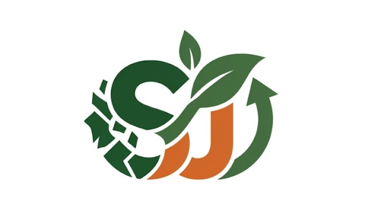

<div align="center">

<!-- SisaJadi Logo -->


# 🌱 SISAJADI

### Marketplace Bahan Sisa Produksi Berkelanjutan

<p>
  <b>Ubah sisa produksi percetakan dan konveksi menjadi bahan baku bernilai guna bagi para pengrajin (<i>crafters</i>) dan mahasiswa.</b>
</p>

<br/>


<br/>


<br/>

[](https://git.io/typing-svg)

</div>

---

## ✨ Tentang SisaJadi

**SisaJadi** adalah platform digital berbasis **ekonomi sirkular** yang mempertemukan pelaku usaha percetakan dan konveksi/garmen dengan para pengrajin (*crafters*), UMKM kreatif, serta mahasiswa untuk memanfaatkan kembali bahan sisa produksi yang masih layak pakai.

Repository ini menggunakan arsitektur **Monorepo** yang menyatukan aplikasi web (`frontend`), server REST API (`backend`), serta rancangan skema database dan kontrak API (`data`) dalam satu ekosistem terintegrasi.

> *"Mengurangi limbah industri kreatif sekaligus membuka akses bahan baku terjangkau untuk karya baru."*

---

## 📌 Latar Belakang

Pelaku industri percetakan dan konveksi menghasilkan sisa produksi rutin setiap hari—seperti kain perca katun, potongan kertas *art carton*, lembaran akrilik, hingga sisa kayu—yang sering kali menumpuk atau terbuang begitu saja karena tidak memiliki saluran distribusi yang tepat.

Di sisi lain, para pengrajin (*crafters*) dan mahasiswa membutuhkan bahan baku dalam jumlah fleksibel dengan harga terjangkau untuk keperluan produksi kriya maupun tugas purwarupa (*prototyping*). **SisaJadi** hadir menjembatani kedua kebutuhan tersebut melalui satu platform terpadu.

---

## 🎯 Tujuan Proyek

* Membantu mitra percetakan dan konveksi menyalurkan bahan sisa produksi secara terstruktur.
* Memudahkan *crafter* dan mahasiswa menemukan bahan sisa berdasarkan kategori, ukuran potongan, gramasi, serta lokasi terdekat.
* Menyediakan fitur chat & negosiasi *real-time* untuk memastikan kesesuaian spesifikasi bahan sebelum transaksi.
* Menghitung dampak lingkungan (*Eco-Impact Tracker*) dari setiap kilogram limbah produksi yang berhasil diselamatkan.

---

## 🚀 Status Lingkungan & Deployment

Saat ini proyek masih berada dalam tahap **pengembangan aktif (Local Development)**:

| Layanan | Environment Lokal | Status Production |
| :--- | :--- | :--- |
| **Frontend Web (React)** | `http://localhost:5173` | 🚧 *In Development* |
| **Backend REST API (Express)** | `http://localhost:5000/api/v1` | 🚧 *In Development* |
| **Real-Time Chat (Socket.io)** | `http://localhost:5000` | 🚧 *In Development* |
| **Mobile App (`sisajadi-mobile`)** | *Repo Terpisah (Flutter)* | ⏳ *Planned* |

---

## 🎨 Identitas Visual & Design System

* **Primary Color (Forest Green):** `#1A5235`
* **Accent Color (Warm Orange):** `#D96B27`
* **Background Surface:** `#F8FAFC` / `#FFFFFF`
* **Typography:** `Plus Jakarta Sans`

---

## 🧩 Fitur Utama (Target MVP)

| Fitur | Deskripsi | Target Pengguna |
| :--- | :--- | :--- |
| 🔐 **Autentikasi & Role** | Registrasi dan login dengan pemisahan peran (*Pembeli/Crafter* vs *Mitra Penjual*) | Semua Pengguna |
| 🔎 **Katalog & Filter Bahan** | Pencarian berdasarkan kategori (*Kain, Kertas, Akrilik, Kayu, Logam*), kondisi, & minimal order | Pembeli |
| 💬 **Chat & Negosiasi Real-Time** | Diskusi ukuran potongan bahan dan pengajuan harga borongan langsung dengan mitra | Pembeli & Mitra |
| 🚚 **Checkout & Opsi Logistik** | Pilihan *Pick-up* di tempat mitra, kurir lokal instan, atau ekspedisi kargo | Pembeli |
| 🌿 **Eco-Impact Tracker** | Kalkulasi otomatis total berat (kg) limbah produksi yang terselamatkan | Semua Pengguna |
| 📊 **Dashboard Mitra Industri** | Ringkasan penjualan, pengelolaan stok bahan sisa (`kg/lembar/roll`), & pesanan masuk | Mitra Penjual |

---

## 🛠️ Tech Stack

<div align="center">

| Frontend | Backend | Database & Data | Real-Time & Media | Mobile Companion |
| :--- | :--- | :--- | :--- | :--- |
| React.js (Vite) | Node.js | MySQL / PostgreSQL | Socket.io | Flutter (Dart) |
| Tailwind CSS | Express.js | Prisma / SQL Schema | Multer | Dio HTTP Client |
| Axios | JWT Auth | JSON Seeder | Cloudinary | *(Repo Terpisah)* |
| Lucide Icons | CORS & Helmet | OpenAPI / Postman | | |

</div>

---

## 🗂️ Struktur Direktori

```text
sisajadi-website/
├── .github/
│   └── CODEOWNERS               # Pengaturan hak persetujuan Pull Request per role/folder
├── frontend/                    # Proyek React.js + Tailwind CSS
│   ├── public/
│   └── src/
│       ├── assets/              # Logo resmi SJ & aset grafis
│       ├── components/          # Komponen UI modular (common, layout, marketplace)
│       ├── context/             # Global state (AuthContext, CartContext)
│       ├── hooks/               # Custom hooks (useMaterials, useSocket)
│       ├── pages/               # Halaman (auth, public, buyer, seller)
│       ├── routes/              # Konfigurasi routing & ProtectedRoute per role
│       ├── services/            # Konfigurasi instance Axios & Socket.io
│       └── utils/               # Helper format mata uang, satuan berat, & tanggal
├── backend/                     # Proyek Node.js + Express
│   └── src/
│       ├── config/              # Koneksi database, Cloudinary, & payment gateway
│       ├── controllers/         # Handler HTTP request & response
│       ├── middlewares/         # JWT Auth, Multer upload, error & response handler
│       ├── models/              # Definisi tabel/model database
│       ├── routes/              # Grouping endpoint REST API (/api/v1)
│       ├── services/            # Logika bisnis utama
│       └── utils/               # Helper token, enkripsi, & logger
├── data/                        # Skema database (ERD/SQL), seeder, & kontrak API
├── .gitignore                   # Aturan pengabaian file sensitif & build
└── README.md                    # Dokumentasi utama proyek
```

---

## 🔄 Alur Aplikasi

```text
Registrasi / Login (Pilih Role: Pembeli atau Mitra Penjual)
        │
        ├──► [Mitra Penjual] Unggah foto & spesifikasi stok bahan sisa (kg/lembar/roll)
        │
        └──► [Pembeli / Crafter] Eksplorasi katalog & filter kategori bahan
                    ↓
             Lihat detail spesifikasi potongan & chat real-time dengan mitra
                    ↓
             Checkout (Pilih Pick-up / Kurir Lokal / Kargo) & Pembayaran
                    ↓
             Pelacakan status pesanan & pencatatan Eco-Impact (kg terselamatkan)
```

---

## 🗃️ Rancangan Database (Planned Schema)

Struktur tabel utama yang disiapkan di dalam direktori `data/`:

| Tabel | Deskripsi |
| :--- | :--- |
| `users` | Menyimpan data akun pengguna, domisili, dan peran (`buyer` / `seller`) |
| `categories` | Master kategori bahan sisa (*Kain Konveksi, Kertas Percetakan, Akrilik, Kayu, Logam*) |
| `materials` | Data katalog bahan sisa, kondisi potongan, harga, satuan, stok, dan minimal pembelian |
| `material_images` | Menyimpan daftar URL foto detail bahan sisa |
| `orders` | Menyimpan transaksi pembelian, metode pengiriman, status pesanan, & total berat limbah |
| `order_items` | Rincian item bahan sisa pada setiap transaksi |
| `messages` | Riwayat pesan chat dan negosiasi antara pembeli dan mitra |

---

## 📡 Standar Integrasi & Rancangan Endpoint API

Seluruh komunikasi antara `frontend`, `backend`, dan `sisajadi-mobile` mengikuti standar berikut:

1. **Prefix Endpoint:** Seluruh route menggunakan awalan `/api/v1/...`.
2. **Format Response JSON Baku:**
   ```json
   {
     "success": true,
     "message": "Daftar bahan sisa berhasil dimuat",
     "data": [],
     "meta": {
       "page": 1,
       "limit": 12,
       "total_items": 48
     }
   }
   ```
3. **Autentikasi Universal:** Menggunakan HTTP Header `Authorization: Bearer <token>`.
4. **Konsistensi Tipe Data:** Nilai harga, stok, dan berat dikirim sebagai tipe numerik murni (`number`), field kosong dikirim eksplisit sebagai `null`, dan *timestamp* menggunakan format **ISO 8601 UTC**.

### Daftar Endpoint Utama (Target MVP)

| Modul | Method | Endpoint | Deskripsi |
| :--- | :--- | :--- | :--- |
| **Health** | `GET` | `/api/v1/health` | Mengecek status server & koneksi database |
| **Auth** | `POST` | `/api/v1/auth/register` | Registrasi akun baru (`buyer` atau `seller`) |
| | `POST` | `/api/v1/auth/login` | Login & menghasilkan JWT token |
| **Materials** | `GET` | `/api/v1/materials` | Mengambil daftar katalog bahan sisa + filter & paginasi |
| | `GET` | `/api/v1/materials/:id` | Mengambil detail bahan sisa & informasi mitra penjual |
| | `POST` | `/api/v1/materials` | Menambah stok bahan sisa baru *(Role: Seller)* |
| | `PUT` | `/api/v1/materials/:id` | Memperbarui data atau stok bahan sisa *(Role: Seller)* |
| **Orders** | `POST` | `/api/v1/orders` | Membuat pesanan baru dari keranjang *(Role: Buyer)* |
| | `GET` | `/api/v1/orders` | Melihat riwayat transaksi pembeli maupun pesanan masuk mitra |
| | `PATCH` | `/api/v1/orders/:id/status` | Memperbarui status pemrosesan/pengiriman pesanan |

---

## ⚙️ Environment Variables

### 1. Backend (`backend/.env`)
Salin `backend/.env.example` menjadi `backend/.env`:
```env
PORT=5000
DATABASE_URL=mysql://root:@localhost:3306/sisajadi_db
JWT_SECRET=ganti_dengan_kunci_rahasia_jwt
CLIENT_URL=http://localhost:5173
```

### 2. Frontend (`frontend/.env`)
Salin `frontend/.env.example` menjadi `frontend/.env`:
```env
VITE_API_BASE_URL=http://localhost:5000/api/v1
VITE_SOCKET_URL=http://localhost:5000
```

---

## 🧪 Panduan Instalasi & Menjalankan di Lokal

### 1. Clone Repository
```bash
git clone [https://github.com/sisajadi/sisajadi-website.git](https://github.com/sisajadi/sisajadi-website.git)
cd sisajadi-website
```

### 2. Setup Backend (`backend/`)
```bash
cd backend
cp .env.example .env
npm install
npm run dev
```
Server API berjalan di `http://localhost:5000`.

### 3. Setup Frontend (`frontend/`)
Buka terminal baru dari direktori root proyek:
```bash
cd frontend
cp .env.example .env
npm install
npm run dev
```
Aplikasi web berjalan di `http://localhost:5173`.

---

## 🤝 Aturan Kolaborasi & Git Workflow

1. **Proteksi Branch Utama:**
   * `main`: Kode stabil siap rilis (*production*). Terkunci penuh dan hanya menerima *merge* dari `develop` via Pull Request.
   * `develop`: Cabang utama integrasi pengujian fitur. Dilarang melakukan `git push` langsung ke `main` maupun `develop`.
2. **Penamaan Branch Fitur & Perbaikan:**
   * Frontend: `feat/web-<nama-fitur>` (contoh: `feat/web-katalog-filter`)
   * Backend: `feat/api-<nama-fitur>` (contoh: `feat/api-auth-jwt`)
   * Data & Docs: `feat/data-<nama-perubahan>` (contoh: `feat/data-schema-sql`)
   * Perbaikan Bug: `fix/<scope>-<nama-bug>`
3. **Urutan Perubahan Kontrak API:** Setiap perubahan *endpoint* atau struktur JSON wajib diperbarui terlebih dahulu di folder `data/`, diimplementasikan di `backend/`, lalu diintegrasikan ke `frontend/` dan `sisajadi-mobile`.
4. **Proteksi Folder (`CODEOWNERS`):** Perubahan pada folder `frontend/`, `backend/`, dan `data/` memerlukan persetujuan (*approval*) dari penanggung jawab *role* masing-masing sebelum di-*merge*.

---

## 📊 Progres Pengembangan Proyek

<div align="center">

| Tahapan / Modul | Status | Keterangan |
| :--- | :--- | :--- |
| Konsep Bisnis, Branding & Logo SJ | ✅ Completed | Identitas visual & *design tokens* ditetapkan |
| Perancangan UI/UX Responsif | ✅ Completed | Rancangan tampilan Desktop, Tablet, & Mobile |
| Setup Organisasi GitHub & Monorepo | ✅ Completed | Struktur `frontend`, `backend`, `data`, & `CODEOWNERS` |
| Skema Database & Kontrak API (`data/`) | 🔄 In Progress | Penyusunan ERD, tabel SQL, & spesifikasi endpoint |
| Setup Boilerplate Backend (`backend/`) | 🔄 In Progress | Inisialisasi Express, middleware response, & auth JWT |
| Setup Boilerplate Frontend (`frontend/`) | 🔄 In Progress | Inisialisasi React + Vite, Tailwind, & konfigurasi routing |
| Fitur Katalog, Detail Bahan & Filter | ⏳ Planned | Tahap pengembangan selanjutnya |
| Fitur Chat Real-Time (Socket.io) | ⏳ Planned | Tahap pengembangan selanjutnya |
| Fitur Checkout, Pelacakan & Dashboard Mitra | ⏳ Planned | Tahap pengembangan selanjutnya |
| Deployment & Integrasi Mobile (Flutter) | ⏳ Planned | Setelah fitur inti web & API stabil |

</div>

---

<div align="center">

### Made with 💚 by SisaJadi Team

<p>
  <b>SisaJadi — Ubah Sisa Produksi Jadi Karya Baru.</b>
</p>

</div>
